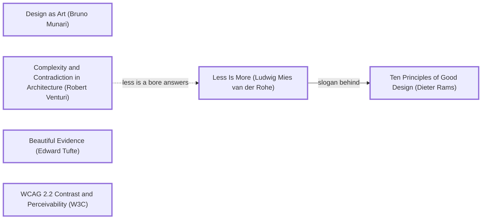

# DESIGN-LOG: ScientificCalcSite → "Show Your Work"

Run date 2026-10-30. Original repo state (a text box handed to math.js) saved on branch `legacy-2026-10-30`.
Read before planning: `dada-lessons/LESSONS.md` (1–35), `GRADES.md` (Lintel B, Learn Groovy B+), and the closest previous run's carry-forward, `learngroovy-site/CARRY-FORWARD.md`.

## Traversal Plan

**Brief, restated.** Totally revamp the scientific calculator site, keeping the old version on a legacy branch.

**Mode: Adaptive.** A calculator is a tool for an audience (students and anyone checking a sum); MAYA governs: the device must be instantly usable, the advanced idea must still be visible.

**Bounded run.** Two WHOLE panel rounds at most (owner's global rule), one agent per reference, three at a time, each filed to `panel/R<n>/<seat>.md`. Lesson 33: Cairo is seated with the sources, because this artifact prints numbers people will copy. Lesson 35: phone claims are measured in a real viewport; panel screenshots are taken at ≥ 500 px and labelled.

**Honesty note.** Moves M1–M4 below were built in one pass in this session and their records written immediately after, before any panel sat; they are not pre-move records in the strict sense. From M5 on, records precede moves.

### Step 0. Tooling inventory
| Job | Tool used |
|---|---|
| Anchor graph | grep on `anchor-graph.md`; Mermaid text below (no renderer) |
| Frontier | by hand from edge lines |
| Workflow state | app task list (`update_plan`) + this log |
| Panel | subagents, one per reference, ≤ 3 at a time, filed to `panel/R<n>/` |
| Measure | built-in browser (computed styles, contrast, overflow, real Tab presses), headless Chrome for panel shots at ≥ 500 px |
| Verify the maths | **Node** (`node tests/calc.test.cjs`, 86 cases) and the build, which evaluates every printed example through the same engine (`_src/eval-examples.cjs`) |
| Persist | `DESIGN-LOG.md` |

### Seed (labels verbatim)
- Stance: **Design as Art (Bruno Munari)**
- Rules: **Less Is More (Ludwig Mies van der Rohe)** —slogan behind→ **Ten Principles of Good Design (Dieter Rams)**; **WCAG 2.2 Contrast and Perceivability (W3C)**
- Breaker: **Complexity and Contradiction in Architecture (Robert Venturi)**
- Counterpoint (dotted): Complexity and Contradiction in Architecture (Robert Venturi) -.->|less is a bore answers| Less Is More (Ludwig Mies van der Rohe)
- Expression: **Beautiful Evidence (Edward Tufte)**
- Criterion: **MAYA: Most Advanced Yet Acceptable (Raymond Loewy)**

### Premortem R0 (the inherited artifact)
- Evidence (Cairo): the placeholder invites `sin(30)`, which math.js evaluates in radians: **−0.988**, presented without a unit. The README promises buttons, clear and backspace that do not exist.
- Usability (Krug): one text box, no keys; a phone user must type `sqrt(` on a soft keyboard.
- Inclusion (Mace): result written into a `` with no live region; no labels beyond "Enter Expression".
Entered as the first Frontier candidates: *say which angle unit*, *keys for phones*, *announce results*.

## Move M1: The device  (KEEP-THE-RULE)
Depends on: none
Anchors: Rule Ten Principles of Good Design (Dieter Rams) | Rule Less Is More (Ludwig Mies van der Rohe) | Stance Design as Art (Bruno Munari)
Intent: A graphite device, round convex keys in a 5×7 grid, one signal-yellow `=`; a glass screen; 2nd-function layer; DEG/RAD always flagged.
Formal argument: Claim: the keypad should be the most familiar object on the page. Grounds: Rams ("as little design as possible"); Munari: a machine that shows how it works. Warrant: MAYA's acceptable pole lives in the keys.
Alternatives rejected: (1) keep the text box only: fails phones (R0). (2) A skeuomorphic replica of a named product: imitation, and a trademark problem.
Consequence: 35 keys must fit 343 px of phone; round keys need `aspect-ratio: 1` and a 44 px floor.
Fence: n/a. Frontier effect: key target size; screen contrast.
Mode field: Acceptable pole (Rams). Advanced pole carried by M2.

## Move M2: Read as  (BREAK)
Depends on: M1, M3
Anchors: Breaker Complexity and Contradiction in Architecture (Robert Venturi) | Counterpoint Less Is More (Ludwig Mies van der Rohe) | Expression Beautiful Evidence (Edward Tufte)
Intent: The screen says more than a calculator must: under the input, the calculation written back with every hidden bracket and implied × (`-2^2` → `−(2^2)`, `sin(30)` → `sin(30°)`); under the answer, the exact double whenever the 12-figure display rounds (`0.1+0.2` → ≈ 0.3, exact 0.30000000000000004). Live, as you type, then committed on `=`.
Formal argument: Claim: the screen should show its work. Grounds: Venturi's both-and against Mies's less; Tufte's evidence placed beside the claim. Warrant: calculators disagree on `-2^2` and `6/2(1+2)`; the only honest answer is one that states its reading.
Alternatives rejected: (1) a "steps" panel below the fold: evidence away from the claim. (2) Silent conventions documented on a help page: nobody reads it at the moment of doubt.
Consequence: the screen is taller; the reading line must wrap, never clip.
Fence: Less Is More exists so a tool stays legible; the reading is set smaller and dimmer than the answer, so the hierarchy holds.
Frontier effect: the site's name becomes **Show Your Work**; a guide page; a tape that keeps the reading.
Mode field: Advanced pole: Venturi, the reading. Acceptable pole: a normal answer, big, right-aligned.

## Move M3: Own the maths  (KEEP-THE-RULE)
Depends on: none
Anchors: Expression Beautiful Evidence (Edward Tufte) | Critic: Evidence (Cairo) (lesson 33)
Intent: Replace math.js with a 300-line engine (tokenizer, Pratt parser, evaluator, reader) in `site/js/calc.js`, and **86 machine-run tests**. Degrees by default, exact trig at multiples of 30°/90° (`sin(180)` = 0, `tan(90)` = error), floating-point residue below 1e-15 in radians shown as 0 with a note. Every example printed on the site is computed by the same engine at build time.
Alternatives rejected: (1) keep math.js: cannot produce the reading (M2) or degree mode without wrapping it, and adds a CDN dependency. (2) Hand-write the reference examples: Learn Groovy's run showed hand-written outputs drift (lesson 33).
Consequence: the build needs Node; the site has no runtime dependency.
Mode field: Acceptable pole: answers people expect (degrees). Advanced: precedence made explicit.

## Move M4: Pages and the tape  (KEEP-THE-RULE)
Depends on: M2, M3
Anchors: Rule Ten Principles of Good Design (Dieter Rams) | multi-page rule
Intent: Calculator (with a thermal-paper tape that keeps each reading, click to reuse, saved in the browser), Functions (21 entries, 39 worked examples), Constants (15, SI 2019 exact / CODATA 2018, values printed as stored), How it reads (12 worked examples and the precedence rules), 404. Links like `index.html?x=sin(30)&mode=rad` load a calculation.
Alternatives rejected: (1) one page: the calculator is one screen, but its reference is not. (2) A modal help: hides the rules.
Mode field: Acceptable pole.

## Move M5: Screen contrast and focus  (KEEP-THE-RULE)
Depends on: M1
Anchors: Rule WCAG 2.2 Contrast and Perceivability (W3C)
Intent: measured before the R1 reports returned: placeholder on glass 3.44:1 → 5.32:1 (#8E8A80); the input's focus cue was a 1 px border colour change → a 3 px signal-yellow underline (10.08:1 on glass). Seats reading the pre-M5 build are told so in R2 (lesson 20).

## Move M6: The seam and the rival  (BREAK)
Depends on: M2, M3
Anchors: Breaker Complexity and Contradiction in Architecture (Robert Venturi) | Expression Beautiful Evidence (Edward Tufte) | critics Debord × Shklovsky (both OBJECT in R1)
Intent: (a) The seam: in READ AS, every character the machine added (brackets, implied ×, °, "rad") is marked in signal yellow with a wavy underline; typed characters stay plain. In RAD, `sin(30)` reads `sin(30 rad)`, so a reading is never a copy of the input. (b) The rival: where calculators genuinely disagree (a number-next-to-bracket after ÷, and a leading minus before a power), the engine evaluates the other reading as well and the screen says "Some calculators read: 6 ÷ (2 × (1 + 2)) = 1". The guide shows the rival beside the reading. (c) READ AS grows (0.95 → 1.05 rem) and brightens.
Formal argument: Claim: the reading must be seen, and must admit it is a choice. Grounds: Shklovsky: an echo line is automatized; marking the seam makes the machine's decisions perceptible. Debord: an answer with no rival is the spectacle's settled fact; showing the other reading turns the device's authority against itself. Warrant: MAYA: both poles on the same line.
Alternatives rejected: (1) Debord's "answer drops a step": OVERRULED in part, citing MAYA's acceptable pole: a calculator whose answer is hard to find fails its first job; the reading gains weight instead. (2) A modal explaining ambiguity: evidence away from the claim.
Consequence: `read()` emits marked segments; `calculate()` returns `rival` (or null). Tests added for both.
Fence: Less Is More: the rival appears only when the two readings give different numbers.
Mode field: Advanced pole: the seam and the rival. Acceptable pole: answer unchanged, biggest.

## Move M7: Cairo's corrections to the engine  (KEEP-THE-RULE)
Depends on: M3
Anchors: Expression Beautiful Evidence (Edward Tufte) | Critic: Evidence (Cairo) R1
Intent: (1) In RAD, floating-point residue is zeroed only when the angle is within 1e-12 (relative) of a non-zero multiple of π/2; `sin(1e-20)` now shows 1 × 10⁻²⁰, not a false 0. (2) Display chooses plain or × 10ⁿ from the value *after* rounding to 12 figures (`999999999999.5` → 1 × 10¹²). (3) `round` sends halves away from zero (`round(-2.5)` = −3), documented. (4) `mod` keeps the sign of the divisor without the add-then-mod step that lost `mod(-1e-20, 3)`. (5) `nPr` multiplies its r factors directly, so `nPr(200,171)` no longer fails on 171!. (6) Guide: "from a trillion up"; asinh/acosh/atanh and sign documented; the home page stops quoting a function count. New tests for each.
Alternatives rejected: (1) keep the broad zeroing with its note: the note was true, the zero was not. (2) BigInt nCr: exactness beyond 2^53 would still be shown to 12 figures; stated as approximate instead.
Mode field: Acceptable pole.
OVERRULE in part (measurement): Cairo's "nPr(200,171) errors although the answer is finite" is false: 200!/29! ≈ 10³⁴³, beyond the largest double (1.8 × 10³⁰⁸); any nPr with r ≥ 171 is at least 171!. The rewrite stays (no factorial detour), and the error now says "too big for a double" instead of naming 171!. Test records it.

## Move M8: Answer first, caveats after  (KEEP-THE-RULE; merge of Krug × Debord, dotted "demands clarity from")
Depends on: M2, M6
Anchors: Critic: Usability (Krug) | Rule Ten Principles of Good Design (Dieter Rams) | Counterpoint MAYA
Intent: Order on the glass becomes input → READ AS → answer → rival → exact double. The rival line is shortened and answer-first ("or 1, if read 6 ÷ (2 × (1 + 2))"). The preview answer brightens (still marked as preview by an "=" that turns solid on commit). Every key with a 2nd function prints that function in small green above its label, like a printed shift legend; EE becomes ×10ⁿ; the angle key shows DEG/RAD with the current unit bold.
Premise test: Krug's "answer is the smallest, dimmest item" was read from a screenshot in preview state. Measured committed answer 41.6 px vs reading 16.8 px: the answer was already the largest; its preview colour was dim (7.27:1). Resolved by ordering and brightening, not by enlarging.
Alternatives rejected: (1) hide the rival behind a tap: evidence away from the claim (Debord, Cairo). (2) Ellipsis on the rival: truncated evidence.
Mode field: Acceptable pole held; the advanced pole (seam, rival) stays on the glass.

## Move M9: The reading without eyes  (KEEP-THE-RULE)
Depends on: M2, M6, M8
Anchors: Rule WCAG 2.2 Contrast and Perceivability (W3C) | Critic: Inclusion (Mace) R1 | The Principles of Universal Design (Ronald Mace et al.)
Intent: Mace showed the site's core idea was sighted-only. (1) A visually hidden live region speaks only on "=": "Read as … Answer … Other calculators may read … giving …"; committed errors go to a role=alert region. (2) Seams carry hidden text: "added (", "added ×", "added degrees". (3) #answer and #detail lose aria-live (they changed on every keystroke). (4) 2nd swaps each key's accessible name with its label (x³ "cubed", ∛ "cube root", sin⁻¹ "inverse sine" …). (5) Accessible names start with the visible text (2.5.3): "DEG, angle unit…", "AC, all clear", "n!, factorial". (6) Key presses no longer pull focus into the input; a keyboard user keeps their place on the keypad. (7) The tape and tables get 4 px padding so outset rings aren't clipped.
Alternatives rejected: (1) make READ AS itself live: it would speak on every keystroke. (2) aria-describedby on the input: read only when focus enters the input, not after "=" on a key.
Mode field: Acceptable pole.

## Move M10: Legible shift legends  (KEEP-THE-RULE)
Depends on: M8
Anchors: Critic: Inclusion (Holmes) R1
Intent: shift legends 10 px → 12 px, weight 600; Ans gets a tooltip. Measured after: see Measurements.

## Move M11: Scientific notation set as type  (KEEP-THE-RULE)
Depends on: M3
Anchors: Rule Thinking with Type (Ellen Lupton) | Critic: Craft (Bringhurst) R1
Intent: "6.02214076 × 10²³" is written as markup wherever a number is shown (screen, tape, functions, constants, guide): a × with .18em margins instead of two mono cells, and the exponent as `` at .62em, weight 500, with a true minus. Variables on the keys (x², xʸ, eˣ, ×10ⁿ) set in italic. Bringhurst's legend size (≥ .72rem) was already met by M10 (12 px, applied before his report arrived; lesson 20).

### Panel, WHOLE, round R1  (artifact: panel/shots/*.png; Debord, Shklovsky, Cairo read the M4 build; Krug, Mace read M6; Holmes, Bringhurst read M8 source, told so in the brief's build note)
All 7 seats filed to `panel/R1/` (one subagent per reference, ≤ 3 at a time, none needed a retry).

| Critic | Anchor used | Observed in the work | Verdict | Resolution |
|---|---|---|---|---|
| Critic: Provocateur (Debord) | theses 4, 34; détournement | the answer is the spectacle; READ AS a caption; 6/2(1+2) = 9 shown as settled fact | OBJECT | M6 (rival reading); "answer drops a step" OVERRULED (MAYA) |
| Critic: Provocateur (Shklovsky) | Art as Technique | nothing marks what the machine added; RAD reading equals the input | OBJECT | M6 (seam; `sin(30 rad)`) |
| Critic: Evidence (Cairo) | The Truthful Art | false zero for sin(1e-20) in RAD; display threshold before rounding; prose "above a trillion"; uncounted functions; round(-2.5); mod tiny negatives; nPr 171 | OBJECT | M7; nPr premise OVERRULED by measurement |
| Critic: Usability (Krug) | Don't make me think | answer "smallest, dimmest"; rival wordy and wraps; DEG key reads as status; 2nd/EE unexplained | OBJECT | M8 (order, shift legends, ×10ⁿ, DEG/RAD key); size premise refuted (41.6 px vs 16.8 px; screenshot was a preview) |
| Critic: Inclusion (Mace) | Perceptible Information | the reading is sighted-only; chatty live regions; aria names lie under 2nd; focus pulled to input; rings clipped | OBJECT | M9 |
| Critic: Inclusion (Holmes) | persona spectrum | 10 px shift legends | OBJECT (small) | M10 |
| Critic: Craft (Bringhurst) | mathematical composition | × 10ⁿ spacing in mono cells; faked superscripts; upright x | OBJECT | M11 (legend size already met by M10) |

Sharpest disagreement: Debord (demote the answer) vs Krug (the answer is the only thing a hurried user wants), a dotted pair in the graph ("demands clarity from"). Resolved as M8's order: answer first and largest, the rival directly under it.
Andon pulled: no.

### Panel, WHOLE, round R2 (partial at push time)
Filed: Debord PASS (the engine-generated rival delivers the contestable answer; overruling "answer drops a step" accepted), Shklovsky PASS (seams and `sin(30 rad)` meet both R1 objections). Cairo, Krug and Mace were still running when the owner asked to push; their reports, if they arrive, land in `panel/R2/` and are resolved in a follow-up commit.

## Stop test (at push, by the owner's call)
- S1 Frontier: open items: R2 verdicts from Cairo, Krug, Mace; Holmes and Bringhurst not re-seated. **Not met.**
- S2, S3: **not met** (R2 incomplete).
- S4 ambition push: M2 (READ AS) escalated by M6 (the seam and the rival); measured: the reading line went from a plain echo to marked additions (10 seams on the guide page) plus an engine-computed rival on 2 of 12 guide rows. **Met.**
- S5 dotted edges: Venturi → Mies applied (M2, M6); Krug ↔ Debord dotted pair resolved by M8. **Met.**

## Measurements at final state (2g, at push)
| Printed figure | Procedure | Value | Status |
|---|---|---|---|
| Every example on functions/guide (63) | evaluated by `site/js/calc.js` during `python _src/build.py` | 63/63 evaluate without error | reproducible |
| Engine tests | `node tests/calc.test.cjs` | 113 passed, 0 failed | reproducible |
| Constants (15) | values printed from the engine's own `CONSTANTS`; SI 2019 / CODATA 2018 checked by Cairo R1 | all match | reproducible |
| "12 significant figures", "from a trillion up and below a millionth" | `fmt()` | matches (tests 999999999999.5, 1e12, 0.000001, 9.9999999999999e-7) | reproducible |
| Contrast: seams 10.08 (glass) / 5.36 (cream) / 4.98 (tape); legend 4.74; placeholder 5.32 | WCAG luminance on computed colours | ≥ 4.5 | measured |
| Phone width | `scrollWidth` at 375 px, all 5 pages | 371–375 | measured |

## Double loop (provisional)
The panel's best move again came from a rival pair: Debord and Shklovsky both objected to the same line for opposite reasons, and the merge (M6) made the site's name literal. Cairo again found the only factual errors, this time with Node in hand; one of Cairo's own premises (nPr) failed a measurement. Process amendment: seat Cairo with a runnable engine whenever one exists; it turns an evidence seat into a test author.

## Carry-Forward Ledger
- A Pratt parser gives implied multiplication the same binding power as ×/÷, so `6/2(1+2)` = 9; state it and show the rival rather than pick silently.
- In degree mode, snap sin/cos/tan at exact multiples of 90° before calling Math; in radian mode zero only near non-zero multiples of π/2, never because |result| is small.
- Choose plain vs × 10ⁿ from the value after rounding to the display precision, or 999999999999.5 prints 13 digits.
- Live regions that update on every keystroke are noise; announce on commit only.

### Panel R2, completed after the push
Krug PASS (withdrew the R1 "answer smallest" premise), Cairo PASS (every rival correct, no false rivals across 20 probes), Mace OBJECT (small): `<output>` is an implicit status live region; the "=" pseudo-content is voiced; key presses give no screen-reader feedback; tape label drops the reading. Holmes and Bringhurst were not re-seated (bounded run).

## Move M12: Quiet until asked  (KEEP-THE-RULE)
Depends on: M9
Anchors: Critic: Inclusion (Mace) R2
Intent: `#answer` becomes a plain span (no implicit live region); the "=" pseudo-content gets empty alt text (`content: "=" / ""`); each key press echoes its name in a polite region; tape entries are labelled "x = answer, read as reading. Use again". Not re-seated: Mace's confirmation is an open item.
